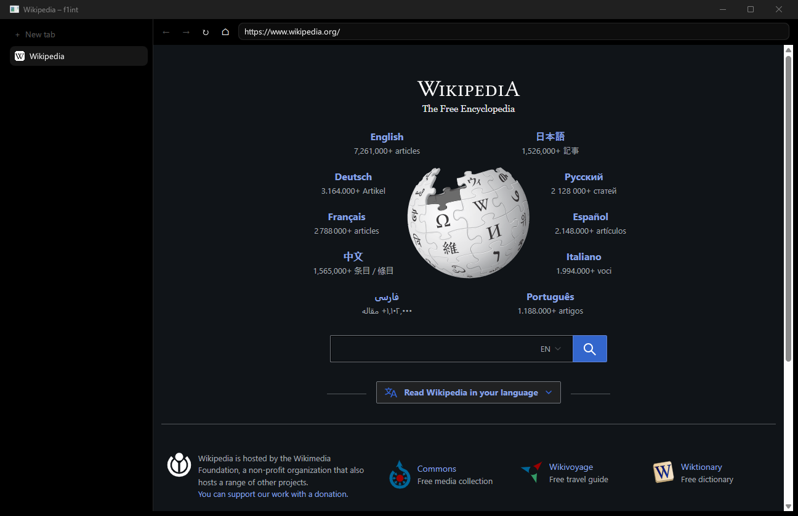

# f1int

A low-RAM desktop web browser built on Chromium (through Qt WebEngine), with a
vertical tab bar and a monochrome look. Free and open source (MIT).



> **Early preview.** f1int is at stage 1a: one tab, address bar with search,
> back / forward / reload / home. Real tabs, history, bookmarks, tab sleeping,
> ad blocking, a password manager and more are on the way.

## Install

Download the installer for your computer from the
[Releases page](https://github.com/FRENCHIIIFRIES/f1int/releases):

| Computer | File |
|---|---|
| Windows 10/11 (64-bit) | `f1int-…-windows-x64.exe` |
| Mac with Apple Silicon (M1 or newer) | `f1int-…-macos-arm64.dmg` |
| Mac with Intel chip | `f1int-…-macos-x86_64.dmg` |

The installers are not signed yet, so your computer will warn you the first time:

- **Windows:** "Windows protected your PC" → click **More info** → **Run anyway**.
- **Mac:** open the `.dmg`, drag f1int to Applications, then **right-click** f1int →
  **Open** → **Open**. If macOS says the app "is damaged", run this once in Terminal:
  `xattr -cr /Applications/f1int.app`

## RAM use

One Wikipedia tab, measured with `tools/measure-ram.ps1` on Windows 11
(private bytes, all processes added up):

| | RAM |
|---|---|
| f1int 0.1 | 240 MB |
| Chrome | 340 MB |

## Build it yourself (Windows)

You need:
- Visual Studio Build Tools (2022 or newer) with **Desktop development with C++**
- Qt 6.12 from the [Qt online installer](https://www.qt.io/download-qt-installer-oss)
  with: **MSVC 2022 64-bit**, **Qt WebChannel**, **Qt Positioning**, and
  **Extensions → Qt WebEngine → MSVC 2022 x64**

```powershell
.\build.ps1 -Run       # build and start f1int
.\build.ps1 -Test      # build and run the unit tests
.\build.ps1 -Zip       # build a portable .zip in build\package
.\build.ps1 -Package   # build the setup .exe (needs NSIS)
powershell -ExecutionPolicy Bypass -File tools\measure-ram.ps1   # RAM: f1int vs Chrome
```

If PowerShell refuses to run scripts, start them as
`powershell -ExecutionPolicy Bypass -File .\build.ps1 -Run`.

## Release installers

`.github/workflows/build.yml` builds all three installers on GitHub. It needs two
repository secrets with a free Qt account (Settings → Secrets and variables →
Actions): `QT_EMAIL` and `QT_PW`. Push a tag like `v0.1.0` and the installers are
attached to a new Release.

## Project layout

- `src/` C++: start-up, Chromium flags, the shared browser profile, address bar logic
- `qml/` the browser UI (tab bar, toolbar)
- `tests/` unit tests
- `tools/` build helpers and the RAM measurement script
- `licenses/`, `THIRD_PARTY_NOTICES.md` Qt (LGPL-3.0) and other licences
